<picture>
  <source media="(prefers-reduced-motion: reduce) and (max-width: 600px)" srcset="docs/readme/hero-mobile.svg">
  <source media="(prefers-reduced-motion: reduce)" srcset="docs/readme/hero.svg">
  <source media="(max-width: 600px)" srcset="docs/readme/motion/hero-mobile.svg">
  
</picture>

Настольный клиент Codex CLI для **Fedora KDE** с доступом к чатам с телефона по локальной сети.

Чаты можно собирать в папки, закреплять и открывать с телефона по QR-коду. В чате можно прикреплять файлы и отвечать на запросы MCP, а в разделе «Подключения» подключать сервисы из каталога Codex. В режиме Auto оркестратор распределяет задачи между субагентами, а их ход работы виден в основном чате. В v2 появилась тёмно-зелёная тема с эффектом жидкого стекла.

*by krkss*

<picture>
  <source media="(prefers-reduced-motion: reduce)" srcset="docs/readme/stack/tech-1.svg">
  
</picture>
<picture>
  <source media="(prefers-reduced-motion: reduce)" srcset="docs/readme/stack/tech-2.svg">
  
</picture>
<picture>
  <source media="(prefers-reduced-motion: reduce)" srcset="docs/readme/stack/tech-3.svg">
  
</picture>
<picture>
  <source media="(prefers-reduced-motion: reduce)" srcset="docs/readme/stack/tech-4.svg">
  
</picture>
<picture>
  <source media="(prefers-reduced-motion: reduce)" srcset="docs/readme/stack/tech-5.svg">
  
</picture>
<picture>
  <source media="(prefers-reduced-motion: reduce)" srcset="docs/readme/stack/tech-6.svg">
  
</picture>

<h2 id="возможности">
<picture>
  <source media="(prefers-reduced-motion: reduce) and (max-width: 600px)" srcset="docs/readme/headings/section-1-mobile.svg">
  <source media="(prefers-reduced-motion: reduce)" srcset="docs/readme/headings/section-1.svg">
  <source media="(max-width: 600px)" srcset="docs/readme/motion/headings/section-1-mobile.svg">
  
</picture>
</h2>

- **Чаты и папки:** создание, поиск, переименование, закрепление и перенос перетаскиванием.
- **Параметры агента:** модель с каскадным выбором reasoning, отдельный Fast и переключатель трёх режимов доступа.
- **Auto:** каскадный выбор оркестратора и модели для лёгких задач из каталога Codex, с сохранением выбранной пары у чата.
- **Лимиты:** две стеклянные шкалы остатка и время до сброса.
- **Удобная переписка:** потоковые ответы, Markdown, блоки кода и копирование. Enter останавливает текущую работу и отправляет новое сообщение; Shift + Enter добавляет строку.
- **Работа с файлами:** открытие локальных файлов, папок и внешних ссылок из сообщений.
- **Понятный статус:** видно, что агент делает — читает файлы, ищет, выполняет команду или пишет ответ.
- **Вопросы и разрешения:** ответы и подтверждения прямо в интерфейсе.
- **Уведомления:** системное уведомление со звуком, когда требуется действие пользователя.
- **Длинные диалоги:** загрузка истории частями, отрисовка видимой области и ограниченный кэш.
- **Управление историей:** удаление чатов или переписки с выбранного хода.
- **Локальное сохранение:** папки, закрепления, названия и черновики сохраняются между запусками.

Удаление переписки с сообщения убирает соответствующий ход целиком и все последующие сообщения.

<h2 id="история-обновлений">
<picture>
  <source media="(prefers-reduced-motion: reduce) and (max-width: 600px)" srcset="docs/readme/headings/section-7-mobile.svg">
  <source media="(prefers-reduced-motion: reduce)" srcset="docs/readme/headings/section-7.svg">
  <source media="(max-width: 600px)" srcset="docs/readme/motion/headings/section-7-mobile.svg">
  
</picture>
</h2>

Сборки с 24 октября по 18 ноября 2026 года.

### 18 ноября 2026 — 2.2.0

- Для каждого чата можно отдельно выбрать модель оркестратора и модель для лёгких задач в режиме Auto.
- Настройки открываются в порядке **Auto -> Оркестратор -> Лёгкие задачи -> Reasoning** на компьютере и телефоне.
- В каталоге моделей Codex показываются GPT‑6.2 Sol и GPT‑6.2 Astra, когда эти модели доступны аккаунту.

### 17 ноября 2026 — 1.9.0–2.1.0

- Появился режим Auto. В первой версии Sol 6.1 распределял задачи между исполнителями, начиная с Luna 6, и проверял результаты. После успешного запуска Auto сохраняет итоги и удаляет чаты исполнителей этого запуска.
- Субагенты отображаются ветками под основным чатом. В общей сводке видны их задачи, ход работы и результаты. Исправлено исчезновение главного чата.
- Обновлён интерфейс: тёмно-зелёная тема, жидкое стекло, переходы, иконка приложения, ярлыки Fedora и версия интерфейса для телефона.
- Остаток лимитов показан двумя цветными шкалами с отсчётом до сброса, например `4h 32m` и `5d 4h 32m`.
- Reasoning открывается справа от списка моделей. Fast вынесен в отдельную кнопку. Доступ переключается между чтением, работой в проекте и полным доступом.
- Убраны надпись «Агент активен» и выбор рабочей папки.
- Во время работы Enter запрашивает остановку текущего ответа и активных субагентов, затем отправляет новое сообщение. При ошибке отправки текст возвращается в черновик.

### 12 ноября 2026 — 1.8.0

- Добавлен режим Fast для поддерживаемых моделей. Выбор сохраняется для каждого чата и доступен на компьютере и телефоне.

### 8 ноября 2026 — 1.7.0–1.7.1

- В разделе «Подключения» можно искать Gmail и другие сервисы из каталога Codex, устанавливать подключения и проходить вход в браузере.
- Большой каталог загружается постепенно; при сетевых сбоях уже полученные результаты сохраняются.

### 3 ноября 2026 — 1.6.1

- Формы MCP и запросы подтверждения отображаются прямо в чате.

### 30 октября 2026 — 1.6.0

- На компьютере и телефоне можно прикреплять файлы перетаскиванием или через кнопку скрепки, а до отправки — удалять вложения.

### 25 октября 2026 — 1.5.0–1.5.3

- Добавлено подключение телефона к чатам по QR-коду через локальную сеть, а также папки, запросы агента и просмотр квот.
- Сопряжение и порт сохраняются. Если локальный IP компьютера не изменился, после повторного включения доступа можно использовать прежнюю ссылку.

### 24 октября 2026 — 1.0.0–1.4.1

- Первая версия получила бело-красную тему, чаты, папки, поиск, закрепление переписок и ярлык Fedora.
- Добавлены выбор модели, reasoning и режима доступа; открытие локальных ссылок; удаление чата или истории начиная с выбранного сообщения.
- Добавлены звук при запросах действий, индикатор активности, постраничная загрузка истории, а также отображение лимита и времени сброса для окон в 5 часов и неделю.

<h2 id="телефон-и-скриншоты">
<picture>
  <source media="(prefers-reduced-motion: reduce) and (max-width: 600px)" srcset="docs/readme/headings/section-2-mobile.svg">
  <source media="(prefers-reduced-motion: reduce)" srcset="docs/readme/headings/section-2.svg">
  <source media="(max-width: 600px)" srcset="docs/readme/motion/headings/section-2-mobile.svg">
  
</picture>
</h2>

Подключите компьютер и телефон к одной Wi-Fi сети. В UniCode откройте подключение телефона, включите его, отсканируйте QR-код и подтвердите устройство на компьютере. Для локального HTTPS используется собственный сертификат; порядок первого подключения описан в [docs/phone.md](docs/phone.md).

С телефона доступны чаты, папки, потоковые ответы, вопросы и разрешения, управление историей и просмотр лимитов. Работа агента и файлы проекта остаются на компьютере.

<details>
<summary>Скриншоты интерфейса UniCode v1</summary>

[](docs/preview.png)
[](docs/chat.png)

</details>

<h2 id="запуск">
<picture>
  <source media="(prefers-reduced-motion: reduce) and (max-width: 600px)" srcset="docs/readme/headings/section-3-mobile.svg">
  <source media="(prefers-reduced-motion: reduce)" srcset="docs/readme/headings/section-3.svg">
  <source media="(max-width: 600px)" srcset="docs/readme/motion/headings/section-3-mobile.svg">
  
</picture>
</h2>

Приложение ориентировано на **Fedora KDE**.

Понадобятся:

- Node.js 22.12+ и npm.
- Установленный Codex CLI, доступный командой `codex`.
- Выполненный вход в Codex CLI.

Если вход ещё не выполнен:

```bash
codex login
```

Сборка и установка ярлыков:

```bash
git clone https://github.com/Kriksson/UniCode.git
cd UniCode
npm ci
npm run pack
node scripts/install-fedora.mjs release
```

После установки UniCode появится в меню приложений и на рабочем столе. Также его можно запустить командой:

```bash
~/.local/bin/unicode-v1
```

Папку проекта нужно оставить на месте: ярлык использует собранное приложение внутри неё.

<h2 id="разработка">
<picture>
  <source media="(prefers-reduced-motion: reduce) and (max-width: 600px)" srcset="docs/readme/headings/section-4-mobile.svg">
  <source media="(prefers-reduced-motion: reduce)" srcset="docs/readme/headings/section-4.svg">
  <source media="(max-width: 600px)" srcset="docs/readme/motion/headings/section-4-mobile.svg">
  
</picture>
</h2>

```bash
npm ci
npm run dev
```

Сборка интерфейса:

```bash
npm run build
```

Создание AppImage:

```bash
npm run dist
```

Результаты сборки находятся в `release/`.

<h2 id="проверки">
<picture>
  <source media="(prefers-reduced-motion: reduce) and (max-width: 600px)" srcset="docs/readme/headings/section-5-mobile.svg">
  <source media="(prefers-reduced-motion: reduce)" srcset="docs/readme/headings/section-5.svg">
  <source media="(max-width: 600px)" srcset="docs/readme/motion/headings/section-5-mobile.svg">
  
</picture>
</h2>

```bash
npm test
npm run build
npm run test:ui
```

Node-проверки находятся в [tests](tests), UI-сценарии — в [tests/ui](tests/ui). UI-сценарии запускают Electron и требуют графической сессии или виртуального дисплея. Основные сценарии используют локальную RPC-фикстуру; отдельная проверка упакованной версии при готовой сборке подключается к установленному Codex CLI. Параметры запуска задаёт [playwright.config.mjs](playwright.config.mjs).

<h2 id="данные">
<picture>
  <source media="(prefers-reduced-motion: reduce) and (max-width: 600px)" srcset="docs/readme/headings/section-6-mobile.svg">
  <source media="(prefers-reduced-motion: reduce)" srcset="docs/readme/headings/section-6.svg">
  <source media="(max-width: 600px)" srcset="docs/readme/motion/headings/section-6-mobile.svg">
  
</picture>
</h2>

UniCode подключается к локальному процессу `codex app-server` и использует авторизацию Codex CLI.

История переписок хранится в Codex CLI. Настройки интерфейса и черновики — в:

```text
~/.config/UniCode v1/state.json
```
