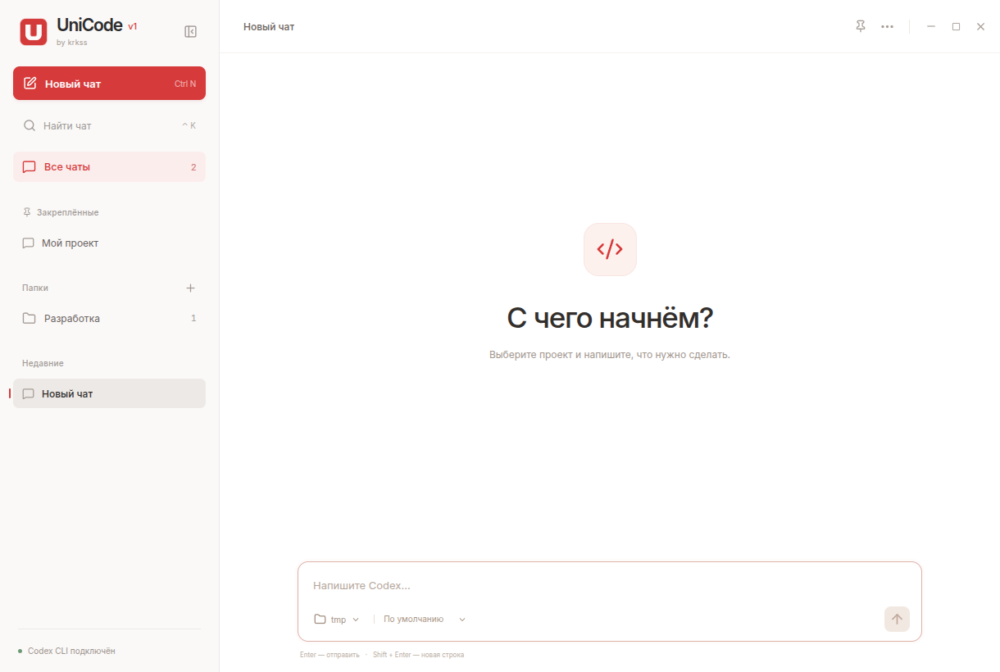
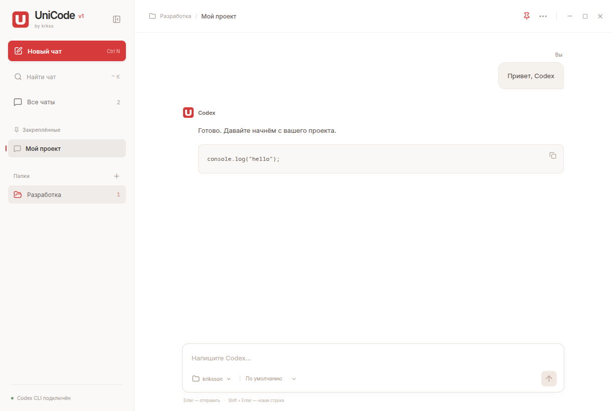

<picture>
  <source media="(prefers-reduced-motion: reduce) and (max-width: 600px)" srcset="docs/readme/hero-mobile.svg">
  <source media="(prefers-reduced-motion: reduce)" srcset="docs/readme/hero.svg">
  <source media="(max-width: 600px)" srcset="docs/readme/motion/hero-mobile.svg">
  
</picture>

Настольный клиент Codex CLI для Linux с чатами, папками, потоковыми ответами и локальным подключением телефона. Работает с процессом `codex app-server` и использует авторизацию Codex CLI.

<picture>
  <source media="(prefers-reduced-motion: reduce)" srcset="docs/readme/stack/tech-1.svg">
  
</picture>
<picture>
  <source media="(prefers-reduced-motion: reduce)" srcset="docs/readme/stack/tech-2.svg">
  
</picture>
<picture>
  <source media="(prefers-reduced-motion: reduce)" srcset="docs/readme/stack/tech-3.svg">
  
</picture>
<picture>
  <source media="(prefers-reduced-motion: reduce)" srcset="docs/readme/stack/tech-4.svg">
  
</picture>
<picture>
  <source media="(prefers-reduced-motion: reduce)" srcset="docs/readme/stack/tech-5.svg">
  
</picture>
<picture>
  <source media="(prefers-reduced-motion: reduce)" srcset="docs/readme/stack/tech-6.svg">
  
</picture>

<h2 id="возможности">
<picture>
  <source media="(prefers-reduced-motion: reduce) and (max-width: 600px)" srcset="docs/readme/headings/section-1-mobile.svg">
  <source media="(prefers-reduced-motion: reduce)" srcset="docs/readme/headings/section-1.svg">
  <source media="(max-width: 600px)" srcset="docs/readme/motion/headings/section-1-mobile.svg">
  
</picture>
</h2>

- **Чаты и папки:** создание, поиск, переименование, закрепление и перенос перетаскиванием.
- **Параметры агента:** выбор модели, reasoning и режима доступа для каждого чата.
- **Удобная переписка:** потоковые ответы, Markdown, блоки кода и копирование.
- **Работа с файлами:** открытие локальных файлов, папок и внешних ссылок из сообщений.
- **Понятный статус:** видно, что агент делает — читает файлы, ищет, выполняет команду или пишет ответ.
- **Вопросы и разрешения:** ответы и подтверждения прямо в интерфейсе.
- **Уведомления:** системное уведомление со звуком, когда требуется действие пользователя.
- **Длинные диалоги:** загрузка истории частями, отрисовка видимой области и ограниченный кэш.
- **Управление историей:** удаление чатов или переписки с выбранного хода.
- **Локальное сохранение:** папки, закрепления, названия и черновики сохраняются между запусками.

Удаление переписки с сообщения убирает соответствующий ход целиком и все последующие сообщения.

<h2 id="телефон-и-скриншоты">
<picture>
  <source media="(prefers-reduced-motion: reduce) and (max-width: 600px)" srcset="docs/readme/headings/section-2-mobile.svg">
  <source media="(prefers-reduced-motion: reduce)" srcset="docs/readme/headings/section-2.svg">
  <source media="(max-width: 600px)" srcset="docs/readme/motion/headings/section-2-mobile.svg">
  
</picture>
</h2>

Подключите компьютер и телефон к одной Wi-Fi сети. В UniCode откройте подключение телефона, включите его, отсканируйте QR-код и подтвердите устройство на компьютере. Для локального HTTPS используется собственный сертификат; порядок первого подключения описан в [docs/phone.md](docs/phone.md).

С телефона доступны чаты, папки, потоковые ответы, вопросы и разрешения, управление историей и просмотр лимитов. Работа агента и файлы проекта остаются на компьютере.

<details>
<summary>Интерфейс приложения</summary>

[](docs/preview.png)
[](docs/chat.png)

</details>

<h2 id="запуск">
<picture>
  <source media="(prefers-reduced-motion: reduce) and (max-width: 600px)" srcset="docs/readme/headings/section-3-mobile.svg">
  <source media="(prefers-reduced-motion: reduce)" srcset="docs/readme/headings/section-3.svg">
  <source media="(max-width: 600px)" srcset="docs/readme/motion/headings/section-3-mobile.svg">
  
</picture>
</h2>

Приложение ориентировано на **Fedora KDE**.

Понадобятся:

- Node.js 22.12+ и npm.
- Установленный Codex CLI, доступный командой `codex`.
- Выполненный вход в Codex CLI.

Если вход ещё не выполнен:

```bash
codex login
```

Сборка и установка ярлыков:

```bash
git clone https://github.com/Kriksson/UniCode.git
cd UniCode
npm ci
npm run pack
node scripts/install-fedora.mjs release
```

После установки UniCode появится в меню приложений и на рабочем столе. Также его можно запустить командой:

```bash
~/.local/bin/unicode-v1
```

Папку проекта нужно оставить на месте: ярлык использует собранное приложение внутри неё.

<h2 id="разработка">
<picture>
  <source media="(prefers-reduced-motion: reduce) and (max-width: 600px)" srcset="docs/readme/headings/section-4-mobile.svg">
  <source media="(prefers-reduced-motion: reduce)" srcset="docs/readme/headings/section-4.svg">
  <source media="(max-width: 600px)" srcset="docs/readme/motion/headings/section-4-mobile.svg">
  
</picture>
</h2>

```bash
npm ci
npm run dev
```

Сборка интерфейса:

```bash
npm run build
```

Создание AppImage:

```bash
npm run dist
```

Результаты сборки находятся в `release/`.

<h2 id="проверки">
<picture>
  <source media="(prefers-reduced-motion: reduce) and (max-width: 600px)" srcset="docs/readme/headings/section-5-mobile.svg">
  <source media="(prefers-reduced-motion: reduce)" srcset="docs/readme/headings/section-5.svg">
  <source media="(max-width: 600px)" srcset="docs/readme/motion/headings/section-5-mobile.svg">
  
</picture>
</h2>

```bash
npm test
npm run build
npm run test:ui
```

Node-проверки находятся в [tests](tests), UI-сценарии — в [tests/ui](tests/ui). UI-сценарии запускают Electron и требуют графической сессии или виртуального дисплея. Основные сценарии используют локальную RPC-фикстуру; отдельная проверка упакованной версии при готовой сборке подключается к установленному Codex CLI. Параметры запуска задаёт [playwright.config.mjs](playwright.config.mjs).

<h2 id="данные">
<picture>
  <source media="(prefers-reduced-motion: reduce) and (max-width: 600px)" srcset="docs/readme/headings/section-6-mobile.svg">
  <source media="(prefers-reduced-motion: reduce)" srcset="docs/readme/headings/section-6.svg">
  <source media="(max-width: 600px)" srcset="docs/readme/motion/headings/section-6-mobile.svg">
  
</picture>
</h2>

UniCode подключается к локальному процессу `codex app-server` и использует авторизацию Codex CLI.

История переписок хранится в Codex CLI. Настройки интерфейса и черновики — в:

```text
~/.config/UniCode v1/state.json
```
